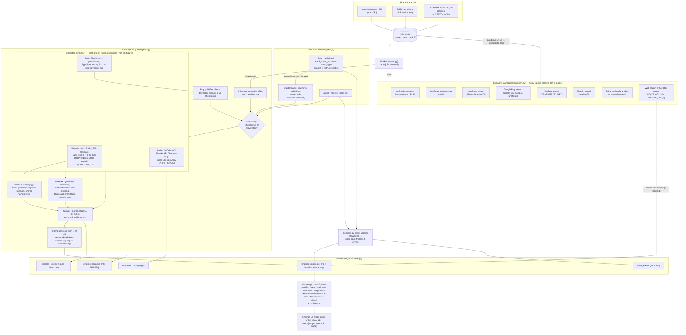

# ThreatDesk architecture

Everything below exists in the code. Optional sources only run when their key is set; without it the check is
recorded as `not_configured` and never produces a result.

## Data flow

## Components

| Layer | Module | Notes |
|---|---|---|
| Collection | `checks/*.py`, `discovery/sources.py`, `discovery/websearch.py` | Each check returns `ran`, `not_possible` (reason) or `not_configured`. Timeouts, HTTP errors, malformed JSON and scraper exceptions become `not_possible`; one failing source never stops a scan. |
| Normalisation | `linkdetect.py`, `lookalike.basic/skeleton` | URLs normalised and given a dedupe key (`instagram:acmebank_help`, `android:com.x`, `host:x.com`); names case-folded, NFKC, confusable and leet characters mapped. |
| Matching | `lookalike.py` | One engine for handles, display names, app titles, developer names, package ids, bio links and intake messages. Returns a score and the techniques used (substitution, added words, spacing, typo). |
| Risk assessment | `scoring.py`, `riskview.py` | Rules carry fixed points and a category. `assess()` caps accounts/apps whose only evidence is name similarity at 35. `riskview` adds the classification and evidence confidence. |
| Exclusion | `investigator.exclusion`, `checks/apps.play_publisher`, `checks/ownership.py`, `reconcile.py` | Official assets (listed, or on the built-in list of a well-known brand the profile matches) and allow-list entries score 0. Defensive registrations get counter-evidence and are classified *Likely brand-owned*; scans don't open findings for them. On Google Play the developer *account id* must match an official app (names are not verified). Findings covered by later profile changes are closed automatically (never one an analyst confirmed). |
| Persistence | `persistence.py`, `models/*` | Findings are unique per org + brand + dedupe key; re-investigation updates the row, evidence is appended. |
| Orchestration | `jobs.py`, `worker.py`, `monitoring.py` | Database job queue with atomic claims, retry with backoff, outage detection (retry instead of saving an empty finding), scheduled scans, retention of background jobs (`JOB_RETENTION_DAYS`). |
| Presentation | `web/*`, `templates/*` | Server-rendered, strict CSP, CSRF on every POST, HTMX polling only. |

## Scoring and classification

* **Signals** come from rules in `scoring.RULES`; each fires at most once per investigation and carries the evidence
  that triggered it.
* **Categories:** name similarity (identity), copied branding, content and behaviour, reputation lists, account and
  registration context, counter-evidence, AI (bounded, labelled).
* **Identity gate (websites, accounts and apps):** when name similarity is the only evidence (corroborating evidence
  below 10 points), the score is capped at 35 and the report says so. The AI read doesn't count as corroboration,
  and neither does absence of data (no archive history, redacted registrant, no TLS). A different publisher is never
  a signal on its own.
* **Counter-evidence:** redirects to an official site, a corporate brand-protection registrar, a registrant matching
  the brand, private nameservers shared with an official domain, an established or platform-verified account.
* **Severity:** High at 70, Medium at 40. Verdicts never say "safe": the lowest are *No strong signals* and
  *Insufficient data*.
* **Classification** (`riskview.classify`): *Verified threat* (analyst confirmed), *Malicious indicators*
  (reputation hit, or credential phishing while posing as the brand), *Suspicious* (score 40+), *Look-alike,
  unconfirmed* (name only), *No strong signals*, *Insufficient data*, *False positive*, *Official asset*.
* **Confidence:** High with two or more independent kinds of evidence (or a reputation hit), Medium with one, Low with
  name-only evidence, too few checks, or user-supplied / search-result data.

## Data sources and freshness

| Source | Access | Freshness |
|---|---|---|
| DNS, RDAP, TLS, Wayback, page fetch, crt.sh, PhishTank, public scam lists | keyless public endpoints | live per investigation (scam lists cached on disk, refreshed in the background) |
| Google Play | `google-play-scraper` (unofficial; breaks when Play changes its pages) | live; official developer ids cached 24 h in-process |
| App Store | iTunes Lookup / Search API | live |
| Bluesky, Telegram public pages | public | live (Telegram existence is a heuristic) |
| YouTube | Data API v3 (`YOUTUBE_API_KEY`) | live |
| Instagram / TikTok / Facebook | Apify actors (`APIFY_TOKEN`, paid), else public OG tags (often a login wall) | live; Apify results cached 24 h in-process |
| Web search | Brave / Google CSE keys | live; findings labelled "FROM SEARCH RESULTS" |
| Demo data | `scripts/seed_demo.py` | synthetic, labelled "Demo fixture" |

Every finding shows when it was last checked, and every check shows whether it ran.
