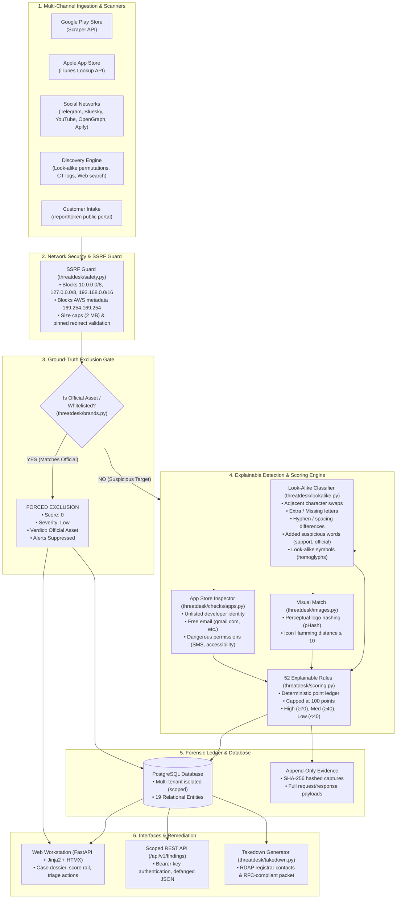

# ThreatDesk — System Architecture Specification

**Product:** ThreatDesk (Digital Risk Protection Platform)  
**Challenge:** ByteXL HacXLerate 2026 — Social & App Monitoring  
**Target:** Brand Impersonation, Fake Social Profiles, Counterfeit Mobile Apps  

---

## 1. High-Level Architecture Diagram

---

## 2. Core Subsystems

### A. Ground-Truth Exclusion Gate (Zero False-Positive Guarantee)
Before any target is scored or alerted, it must pass through the `BrandContext` evaluation gate:
1. **Domain:** Host matches registered `official_domains` or active `AssetWhitelist` domain.
2. **Social:** Platform handle matches `official_handles` for that platform.
3. **App:** Android package name or iOS store ID matches `official_apps`.
4. **Publisher:** App developer name, website domain, or developer email domain matches `official_publishers`.
*Outcome if matched:* Score is forced to **0**, verdict to `"Official/whitelisted asset"`, and no notifications are dispatched.

### B. Explainable Look-Alike Classification Engine
Located in [`threatdesk/lookalike.py`](file:///home/amrit/Projects/C3/threatdesk/threatdesk/lookalike.py), this engine evaluates candidates against brand assets using Damerau-Levenshtein distance, token permutation analysis, and homoglyph mapping:
* **Adjacent Letter Swaps:** Detects transpositions (e.g. `Acme Bnak` $\rightarrow$ `bnak` instead of `bank`).
* **Hyphen / Spacing Variations:** Detects delimiter obfuscation (e.g. `ac-mebank` vs `acmebank`).
* **Added Suspicious Terms:** Identifies prefixes and suffixes targeting brand authority (e.g. `official`, `support`, `verify`, `helpdesk`, `kyc`).
* **Homoglyphs & Leetspeak:** Identifies visual look-alikes (`0` for `o`, `1` for `l`/`i`, `3` for `e`).

### C. Visual Identity Perceptual Hashing
Located in [`threatdesk/images.py`](file:///home/amrit/Projects/C3/threatdesk/threatdesk/images.py):
* Computes DCT-based 64-bit perceptual hash (`pHash`) for uploaded brand logos.
* Downloads candidate app icons and computes perceptual Hamming distance.
* Flags `icon_matches_logo` (+30 points) if distance $\le 10$, pinpointing visual brand theft even if names differ slightly.

### D. Security Boundaries & Defanging
* **Defanging:** In [`threatdesk/safety.py`](file:///home/amrit/Projects/C3/threatdesk/threatdesk/safety.py), all malicious URLs and hostnames are defanged before display in UI, API responses, or CSV exports (`hxxps://`, `[.]` delimiters, stripping `=+-@` formula injection characters).
* **Strict CSP:** Content Security Policy disables all inline scripts (`script-src 'self' https://unpkg.com`), frames (`frame-ancestors 'none'`), and objects (`object-src 'none'`).
* **CSRF Protection:** Every state-changing POST route requires a valid CSRF token derived from user session keys.
